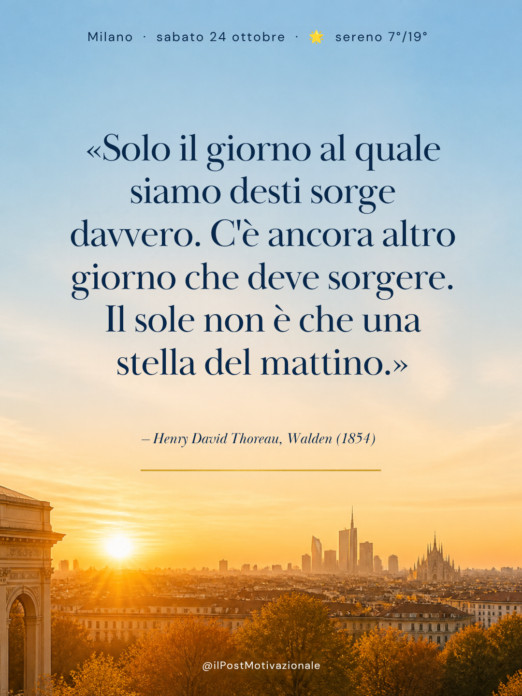

# Contenuti Canva motivazionali — classici 1800–1960

Un flusso di lavoro per creare contenuti motivazionali per i social a partire da **citazioni autentiche** della letteratura classica (opere pubblicate tra il 1800 e il 1960). Il flusso usa Claude e Canva.

Il punto centrale è l'affidabilità. In rete circolano moltissime frasi attribuite a Dostoevskij, Nietzsche o Hugo che questi autori non hanno mai scritto. Per questo ogni citazione viene verificata sul testo dell'opera prima di finire in un post.

## Come funziona

Il lavoro è diviso in due parti. L'**agente** decide *cosa* pubblicare oggi. La **skill** trova e verifica le citazioni.

```
3bmeteo ──► agente: meteo → tema ──► skill citazioni-classiche ──► agente: scelta ──► post Canva
                                     (ricerca + verifica)         della citazione
```

1. **Meteo.** L'agente `post-motivazionale-meteo` legge su 3bmeteo la previsione del giorno per la città (Milano per impostazione predefinita).
2. **Tema.** Dal cielo, dal giorno della settimana e dalla stagione l'agente ricava il tema. Ad esempio: sereno → luce, mattino e ricominciare; nuvoloso → speranza discreta; primo freddo → forza interiore.
3. **Ricerca e verifica.** L'agente passa il tema alla skill `citazioni-classiche`. La skill seleziona le citazioni candidate e verifica ognuna su una fonte affidabile: Project Gutenberg, Liber Liber, Wikisource, Internet Archive o Wikiquote. Le citazioni senza riscontro vengono scartate.
4. **Documento.** I risultati vengono raccolti in un documento. Per ogni citazione ci sono il testo originale, la traduzione italiana, l'autore, l'opera, l'anno, il contesto, la fonte di verifica e lo stato dei diritti d'autore. C'è anche una tabella che indica a quale meteo si adatta ogni citazione.
5. **Scelta e post Canva.** L'agente sceglie la citazione più adatta al meteo del giorno, tra quelle verificate e di pubblico dominio, e la trasforma in un post Instagram su Canva. Le altre restano in archivio per i giorni successivi.

## Contenuto del repository

```
agente/
  post-motivazionale-meteo.md   # agente: meteo 3bmeteo → tema → skill → post Canva
skill/
  citazioni-classiche/
    SKILL.md              # istruzioni della skill per Claude
    references/autori.md  # spunti di autori e opere per tema, attribuzioni false note
esempi-output/
  citazioni-luce-mattino-ricominciare.pdf   # esempio di documento generato
  post-instagram-motivazionale-milano.png   # esempio di post Canva
```

## Esempi di output

- **Documento delle citazioni:** [`esempi-output/citazioni-luce-mattino-ricominciare.pdf`](esempi-output/citazioni-luce-mattino-ricominciare.pdf). Tema "Luce, mattino e ricominciare" (24 ottobre 2026). Contiene 8 candidate: 7 verificate e 1 scartata perché senza fonte. Include anche una tabella di confronto per tono e meteo.
- **Post Canva:** "Post Instagram motivazionale per Milano" (1080×1440), con la citazione di Thoreau scelta nel documento. [Vedi il design su Canva](https://www.canva.com/d/1R6ex0p8HkwI-bP)

<p align="center">
  
</p>

## Usare l'agente

Il file [`agente/post-motivazionale-meteo.md`](agente/post-motivazionale-meteo.md) si può usare in due modi:

- **Come agente di Claude Code:** copialo in `.claude/agents/`.
- **Come istruzioni:** incollalo in un Progetto di claude.ai, oppure nel prompt di un'attività pianificata giornaliera.

Richiede la skill `citazioni-classiche` e il connettore Canva. Per avviarlo basta chiedere:

> «Esegui l'agente post-motivazionale-meteo per Milano, per la data di oggi.»

## Usare la skill

Copia la cartella `skill/citazioni-classiche` tra le skill di Claude, ad esempio caricandola come skill personalizzata su claude.ai. Poi chiedi qualcosa come:

> «Trovami 5 citazioni dai classici sul ricominciare per i miei post»

## Diritti d'autore

Le opere di autori morti da più di 70 anni sono di pubblico dominio in Italia e nell'UE. Per le opere ancora protette (ad esempio Camus), la skill riporta solo citazioni brevi con autore e titolo e le segnala come "opera protetta".
